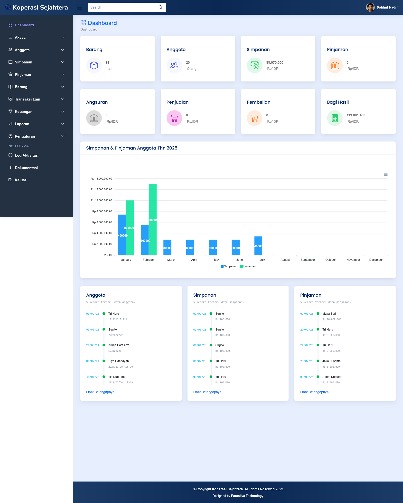

# Aplikasi Koperasi V 3.0.0

Aplikasi Koperasi V 3.0.0 adalah aplikasi open source untuk membantu pengelolaan koperasi secara digital. Dibangun dengan PHP, MySQL, jQuery, dan Bootstrap 4. Cocok untuk koperasi simpan pinjam, koperasi serba usaha, dan koperasi konsumen yang membutuhkan sistem pengelolaan terintegrasi.



## Fitur Utama

| Modul | Deskripsi |
|-------|-----------|
| **Dashboard** | Ringkasan informasi, jam dan pemberitahuan sistem, serta logo, nama, alamat, dan kontak koperasi. |
| **Akses** | Manajemen kode otentifikasi, entitas/level akses (pengurus), dan data pengguna. |
| **Anggota** | Kelola data anggota, pencarian, impor/eksport Excel, dan rekap keluar-masuk anggota. |
| **Simpanan Anggota** | Jenis simpanan, simpanan wajib, log simpanan, dan rekapitulasi simpanan. |
| **Pinjaman Anggota** | Jenis pinjaman, sesi pinjaman, tagihan/tunggakan, dan rekap pinjaman. |
| **Barang/Inventory** | Master barang, batch & expired, stok, supplier, multi harga/satuan, dan ekspor Excel. |
| **Stock Opname** | Daftar sesi, detail, dan ekspor stock opname; nilai selisih tanpa data ditampilkan sebagai Rp 0. |
| **Transaksi Operasional** | Kategori, transaksi, dan rekap transaksi operasional. |
| **Transaksi Jual/Beli** | Penjualan, pembelian, dan rekap transaksi. |
| **Pembukuan Keuangan** | Bagi hasil (SHU), akun perkiraan, dan jurnal keuangan. |
| **Laporan** | Simpan pinjam, buku besar, neraca saldo, laba rugi, riwayat transaksi. |
| **Pengaturan Aplikasi** | Pengaturan umum dengan logo perusahaan responsif, kartu auto jurnal berketinggian seragam, serta konfigurasi auto jurnal simpan-pinjam, jual-beli, dan SHU menggunakan kueri terparameterisasi sesuai tipe kolom database dan toast sukses setelah penyimpanan. |
| **Lainnya** | Log aktivitas, konten bantuan, profil pengguna. |

## Panduan Instalasi
### Persyaratan Sistem

- **PHP**: 7.4 atau lebih baru
- **Database**: MySQL 5.7 / MariaDB 10.3 atau lebih baru
- **Web Server**: Apache (XAMPP, WAMP Server, atau serupa)
- **Browser**: Chrome, Firefox, Edge, atau Safari (versi terbaru)
- **Ekstensi PHP yang diperlukan**: `mysqli`, `gd`, `mbstring`, `zip` 
---

### Skenario A: Instalasi di Web Server Lokal (XAMPP / WAMP Server)

Ikuti langkah-langkah berikut jika Anda menggunakan komputer lokal:

#### 1. Siapkan Web Server
- Pastikan **XAMPP** atau **WAMP Server** terinstal dan berjalan (Apache dan MySQL aktif).
- Buka browser dan kunjungi `http://localhost/` untuk memastikan web server berjalan normal.
#### 2. Letakkan File Aplikasi
- Salin folder aplikasi `koperasi_v3` ke direktori root web server:
  - **XAMPP**: `C:\xampp\htdocs\koperasi_v3`
  - **WAMP Server**: `C:\wamp64\www\koperasi_v3`
- Pastikan struktur folder terlihat seperti berikut:
  ```
  koperasi_v3/
  ├── _Config/
  ├── _Database/
  ├── _Page/
  ├── _Partial/
  ├── assets/
  ├── vendor/
  ├── index.php
  ├── instal.php
  ├── Login.php
  └── README.md
```
#### 3. Buka Installer melalui Browser
- Ketik di address bar browser:
  ```
  http://localhost/koperasi_v3/instal.php
  ```
- **⚠️ PENTING:** Pertama kali instalasi **harus dilakukan melalui `instal.php`** untuk membuat database, struktur tabel, dan pengguna pertama (admin). Jangan langsung membuka `index.php` sebelum menjalankan `instal.php`.
#### 4. Isi Formulir Pengguna Pertama
- Pada halaman `instal.php`, isi data berikut:
  - **Nama pengguna**
  - **Nomor kontak**
  - **Email**
  - **Password** (6–20 karakter alfanumerik)
  - **Konfirmasi password**
- Klik tombol **"Buat pengguna pertama"**.
- Jika berhasil, Anda akan diarahkan ke halaman login.
#### 5. Konfigurasi Koneksi Database (jika perlu)
- Buka file `_Config/Connection.php` dan sesuaikan dengan pengaturan database Anda:
  ```php
  $servername = "localhost";
  $username   = "root";
  $password   = ""; // Kosongkan untuk XAMPP/WAMP default
  $db         = "koperasi"; // Nama database yang akan digunakan
  ```
- Jika Anda mengubah nama database, pastikan nama di `instal.php` sama persis dengan di `Connection.php`.
#### 6. Buka Aplikasi
- Kunjungi:
  ```
  http://localhost/koperasi_v3/
  ```
- Login menggunakan email dan password yang Anda buat pada langkah 4.

---

### Skenario B: Instalasi di Web Hosting (Shared Hosting / VPS)

Ikuti langkah-langkah berikut jika Anda mengunggah aplikasi ke hosting:

#### 1. Upload File ke Hosting
- Unggah seluruh isi folder `koperasi_v3` ke `public_html` (atau folder domain Anda) melalui FTP, File Manager cPanel, atau Git.

#### 2. Buat Database di Hosting
- Masuk ke cPanel (atau panel kontrol hosting Anda).
- Buka **MySQL Databases** dan buat database baru (misal: `koperasi_v3`).
- Buat pengguna database dan berikan hak penuh (ALL PRIVILEGES) ke database tersebut.
- Catat nama database, username, dan password.

#### 3. Sesuaikan Konfigurasi Database
- Buka file `_Config/Connection.php` melalui File Manager atau FTP.
- Ubah pengaturan koneksi sesuai data hosting Anda:
  ```php
  $servername = "localhost"; // atau nama server database dari hosting
  $username   = "username_database_anda";
  $password   = "password_database_anda";
  $db         = "nama_database_anda";
  ```

#### 4. Jalankan Installer
- Buka browser dan kunjungi:
  ```
  https://namadomainanda.com/koperasi_v3/instal.php
  ```
- **⚠️ PENTING:** Installer `instal.php` akan secara otomatis membuat database (jika diperbolehkan) dan struktur tabel dari file `_Database/scema.sql`, lalu membuat pengguna pertama (admin).

#### 5. Isi Formulir Pengguna Pertama
- Isi nama pengguna, nomor kontak, email, dan password.
- Klik tombol **"Buat pengguna pertama"**.
- Setelah selesai, Anda dapat login melalui `https://namadomainanda.com/koperasi_v3/Login.php`.
## ⚠️ Langkah Wajib: Setup Database Awal melalui `instal.php`

Sebelum aplikasi dapat digunakan, Anda **wajib** menjalankan `instal.php` pada awal instalasi. Fungsi installer ini:

1. Membuat database baru (jika belum ada) berdasarkan nama di `Connection.php`.
2. Membuat seluruh struktur tabel dari file `_Database/scema.sql`.
3. Membuat data master hak akses (entitas akses).
4. Membuat **pengguna pertama sebagai Admin** melalui formulir web.
**Catatan:** Data pengguna dan data operasional dari berkas SQL **tidak diimpor** secara otomatis. Hanya struktur tabel dan data master akses yang dibuat. Anda dapat menambahkan data operasional melalui antarmuka aplikasi setelah login.
> Setelah instalasi selesai, **segera hapus atau ubah nama file `instal.php`** untuk alasan keamanan.
---

## Konfigurasi Database (`_Config/Connection.php`)

File ini berisi pengaturan koneksi database aplikasi. Pastikan nilai sesuai dengan environment Anda:

```php
$servername = "localhost";
$username   = "root";
$password   = "";
$db         = "koperasi";
```

| Parameter | Keterangan |
|-----------|------------|
| `$servername` | Host database. Biasanya `localhost` untuk lokal dan hosting. |
| `$username` | Username database. Default XAMPP/WAMP: `root`. |
| `$password` | Password database. Default XAMPP/WAMP: kosong (`""`). |
| `$db` | Nama database yang digunakan aplikasi. |

Jika Anda mengubah nama database, ubah juga di bagian instaler maupun `Connection.php` agar konsisten.
---

## Login Pertama Kali

Setelah menjalankan `instal.php` dan membuat pengguna pertama:

1. Buka `http://localhost/koperasi_v3/Login.php` (lokal) atau `https://domainanda.com/Login.php` (hosting).
2. Masukkan **email** dan **password** yang Anda daftarkan pada installer.
3. Anda akan masuk sebagai **Admin** dengan hak akses penuh.
---

## Keamanan Pasca Instalasi
Langkah-langkah berikut disarankan setelah instalasi selesai:

1. **Hapus atau ganti nama file `instal.php`** agar tidak dapat diakses oleh orang lain.
   ```bash
   # Contoh: ganti nama
   rename instal.php instal.php.bak
   ```
2. Pastikan folder `_Database`, `_Config`, `vendor`, dan direktori sensitif lainnya tidak dapat diakses langsung melalui browser.
3. Ganti password admin pertama melalui menu **Profil Pengguna** setelah login pertama kali.
---

## Troubleshooting

| Masalah | Solusi |
|---------|--------|
| Halaman `instal.php` tidak muncul / error 404 | Pastikan file `instal.php` berada di folder aplikasi dan URLnya benar (`localhost/koperasi_v3/instal.php`). |
| Error koneksi database | Periksa kembali `_Config/Connection.php`. Pastikan MySQL berjalan dan username/password benar. |
| Error "Nama database pada konfigurasi tidak valid" | Nama database hanya boleh berisi huruf, angka, dan underscore (`_`). Tanpa spasi atau karakter khusus. |
| Halaman putih setelah instalasi | Periksa log error PHP/web server. Pastikan ekstensi `mysqli` dan `mbstring` aktif. |
| Tidak dapat login | Pastikan Anda sudah menjalankan `instal.php` dan membuat pengguna pertama. Coba reset password melalui database atau jalankan ulang installer. |

---

## Lisensi

Proyek ini dilisensikan di bawah [LICENSE](LICENSE).
